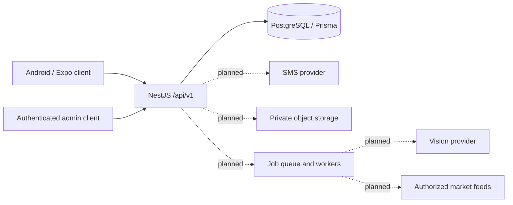
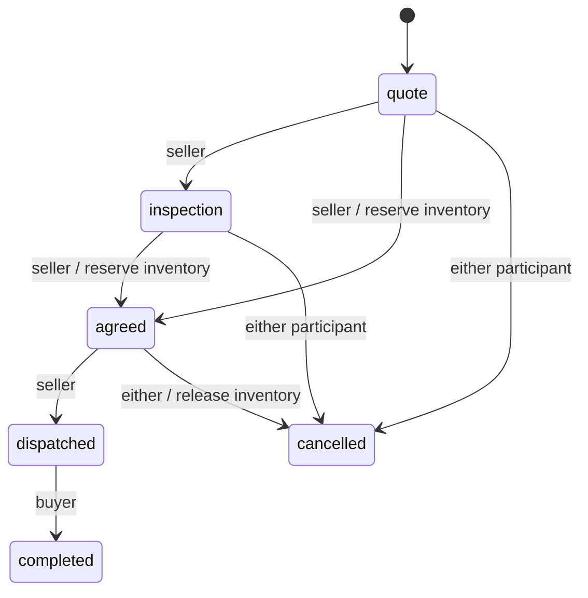

# Agromitra Market backend

This design comes from inspecting the supplied v1.2 APK's bundled `app.js`, `comfort.js`, `smart-data.js`, and `smart-engine.js`. The APK is an offline WebView app, with localStorage state and IndexedDB media. It has no existing server API to reproduce. Its sample identities, prices, approvals, payments and reports are demonstration data; none are seeded into the database.

## Architecture



Use a modular monolith initially. Auth, listings, requests/deals, verification and market data share transactions in one database. Independent workers are appropriate for media scanning, reports, AI and feed imports; splitting transactional marketplace data into services is unnecessary at this stage.

## Implemented foundation

* Indian mobile OTP challenges: random six-digit codes, HMAC digests, five-minute lifetime, maximum five verification attempts, sixty-second resend delay and five requests per phone per hour. Advisory locks serialize operations for the same phone. Development codes are explicitly returned only in development mode; production login returns 503 until an SMS adapter is implemented.
* Revocable, seven-day opaque bearer sessions. Only SHA-256 token hashes are stored. Phone ownership and buyer business approval are separate. Users may buy and sell with the same account.
* Profile editing and admin review of buyer applications. An admin must be provisioned by an operator; no public role elevation exists.
* Listings across all eight APK categories, category-specific units, decimal INR prices, quantities, expiry, draft publication, ownership checks, seller contact preferences and buyer blocking. Public queries never select seller phone numbers. Public text rejects ordinary phone, email and URL patterns; this is not a comprehensive content moderation system.
* Buyer requirements, participant-only deals, idempotent deal creation, immutable quoted unit/price, stage history, optimistic versions and atomic stock reservation/release. Editing listing details is blocked while an open deal exists.
* Admin imports of date-labelled price observations. Duplicate rows are skipped. Matching requires exact product, variety, grade, unit, state, district and price basis. Estimates return latest references separately by market/source from the last seven days. Missing data returns `available: false`. Imported sources remain explicitly unverified.

Decimals serialize as strings. Treat these as exact values in mobile clients. All prices are INR; units refer to the listed sale unit, not a silently inferred unit. All IDs are UUIDs. API timestamps are ISO 8601; market reporting dates are stored as PostgreSQL DATE. There is no fabricated distance, quality score, yield, health result or live-price claim.

## Data ownership and lifecycle

`User` owns `Session`, `BuyerVerification`, `Listing` and `BuyerRequest`. A `Deal` references a listing plus buyer and seller, with a snapshot of unit, unit price and quantity. `DealEvent` records actors and stage changes. `SellerBlock` is scoped to a seller/buyer pair. `ContactEvent` records authorized contact disclosure. `MarketObservation` preserves reporting date, location, price basis, source URL and import provenance.

Deal flow:



Quotes do not reserve stock. A seller can accept only if current stock covers the deal. A buyer can confirm receipt only after dispatch. Completion is a delivery acknowledgement, not proof of payment. Quoted prices currently use the listing asking price; counteroffers and signed acceptance of negotiated terms are a future feature. Disputes after dispatch require a later support workflow.

Contact disclosure requires an authenticated, approved buyer, an active unexpired listing, an enabled channel and no seller block. Call and WhatsApp links are returned only by the gated endpoint and every successful disclosure is recorded. Revocation prevents future disclosures; a phone number already shared cannot be recalled. There is no paid contact entitlement in this foundation.

## API contract

All routes start with `/api/v1`. Protected routes require `Authorization: Bearer <accessToken>`. Validation rejects unknown body/query properties. Standard Nest HTTP errors use `statusCode` and `message`.

| Method and path | Access | Purpose |
| --- | --- | --- |
| GET `/health` | Public | Database readiness; 503 if unavailable |
| POST `/auth/otp/request` | Public | `{ "phone": "+919876543210" }` |
| POST `/auth/otp/verify` | Public | `{ "challengeId": "uuid", "code": "123456" }`; returns session token |
| DELETE `/auth/session` | Signed in | Revoke current session |
| GET / PATCH `/users/me` | Signed in | Read own private profile; edit displayName, city, language |
| POST `/users/me/verification` | Signed in | Submit business and purpose; resubmission resets approval |
| GET `/admin/verifications` | Admin | Oldest 100 pending applications |
| PATCH `/admin/verifications/:userId` | Admin | Review with status approved/rejected and note |
| GET `/listings` | Public | Active unexpired stock; category, city, search, offset, limit |
| GET `/listings/mine` | Signed in | Own listings including drafts |
| GET `/listings/:id` | Public | Active listing and public seller profile |
| POST `/listings` | Signed in | Create a draft |
| PATCH `/listings/:id` | Seller | Replace editable listing fields; increments revision |
| PATCH `/listings/:id/status` | Seller | Set draft/active/paused/sold/withdrawn; terminal statuses cannot reopen |
| PATCH `/listings/:id/contact-settings` | Seller | Set allowCall and allowWhatsapp |
| POST `/listings/:id/contact` | Approved buyer | `{ "channel": "call" }` or whatsapp |
| POST / DELETE `/listings/blocks/:buyerId` | Signed in seller | Block/unblock buyer for this seller |
| GET / POST `/requests` | Public / signed in | Browse or create buyer requirements (title, category, quantity, unit, city, optional budget, purpose, note, expiresAt) |
| POST `/requests/:id/close` | Request owner | Close a requirement |
| GET / POST `/deals` | Signed in | Own deals or create a quote with listingId, quantity, UUID idempotencyKey |
| GET `/deals/:id` | Participant | Deal and stage history |
| PATCH `/deals/:id/stage` | Participant | `{ "stage": "agreed", "version": 1 }`; 409 on stale version |
| GET / POST / DELETE `/saved` (`/:listingId` for writes) | Signed in | Per-user saved listings persisted in Prisma |
| GET / POST `/conversations` | Signed in | Own conversations; start an enquiry with `{ "listingId": "uuid" }` |
| POST `/conversations/:id/messages` | Participant | `{ "text": "message" }`; real messages only, up to 600 characters |
| POST / PATCH `/listings/:id/media` | Listing owner | Multipart `file` and `clientKey` query to upload; `{ "ids": [...] }` to set order/remove media |
| GET `/media/:id` | Public active listing | Photo/video bytes; supports byte ranges |
| GET `/listings/:listingId/media/:id` | Listing owner | Authenticated media access for drafts/paused listings |
| POST `/market/imports` | Admin | `{ "records": [...] }`, maximum 500 validated observations |
| GET `/market/observations` | Public | Latest 100 observations; optional exact product, variety, grade, unit, basis, state and district filters |
| GET `/market/estimate` | Public | Separate recent references; no guaranteed sale price |

List defaults: offset 0, limit 20, maximum limit 100. Listing list responses contain `{items,total,offset,limit}`. Other collection endpoints return `{items}`. Private verification records do not appear in public listings or requests.

Create listing example (set expiresAt to a future timestamp within 90 days):

```json
{
  "title": "Sona Masoori paddy",
  "description": "Bulk lot; buyer can inspect before confirming quality.",
  "category": "crops",
  "product": "Paddy",
  "variety": "Sona Masoori",
  "grade": "Unspecified",
  "details": [{ "label": "Packing", "value": "50 kg bags" }],
  "unit": "quintal",
  "price": 2600,
  "quantity": 100,
  "minimumOrder": 10,
  "city": "Guntur",
  "district": "Guntur",
  "state": "Andhra Pradesh",
  "expiresAt": "<future ISO timestamp>"
}
```

This example is illustrative input, not a current market quotation. Publish the returned listing ID with `{ "status": "active" }`. Consent starts disabled; enable channels explicitly using the contact-settings route.

Market queries require product, variety, grade, unit, basis, state and district. Import rows require those fields plus market, reportedAt (`YYYY-MM-DD`), minimum, modal, maximum, sourceName and an HTTPS sourceUrl. A URL is provenance metadata; the server does not fetch arbitrary submitted URLs. No automatic unit conversion or fallback matching is implemented.

## Remaining APK features and implementation design

| Feature | Next implementation |
| --- | --- |
| Photos/video | Private S3-compatible objects, owner-bound upload intents, size/MIME limits, checksums, malware scanning, transcoding and short-lived signed reads. Link media to listing revision; invalidate old reports on edits. |
| Quality evidence | Category-specific typed facts and document references, with seller-declared, lab-measured and vet-assessed provenance kept separate. Public media needs review/redaction before exposure. |
| AI analysis | Durable AnalysisJob with queued/running/completed/failed states and idempotency key. Worker records model version, media checksums, listing revision, observations and uncertainty. Reject stale reports; do not infer health, fertility, measured weight, milk yield or lab values from appearance. |
| Buyer reports | Server-generated report snapshots containing reference dates, evidence provenance and revision, excluding phone numbers; access through signed URLs. |
| Messages/enquiries | Conversation participants bound to listing/deal; paginated messages, abuse reporting, attachment scanning, push notifications and server authorization on every read/write. |
| Saved listings | Composite unique User/Listing record, with owner-only collection endpoints. |
| Notifications | Transactional outbox, idempotent worker delivery, device tokens and per-user read state. |
| Payments/subscriptions/promotions | Provider-created orders, signature-verified webhooks, unique provider event IDs, immutable payment ledger, refund events and independently calculated entitlements. Client callbacks never grant paid status. |
| Inspections/logistics | Booking records, independent service providers, scheduled timestamps and documented cancellation/acceptance rules. |
| Support/ratings | Participant-bound tickets and reviews, moderation queue and explicit dispute lifecycle. |
| Live market feeds | Authorized provider adapters with schema/unit validation, preserved reporting dates, source credentials and scheduled ingestion. Keep mandi, asking, completed-trade and processor prices separate. |

## Connecting the frontend

The `frontend/` app now has a connected mode (see `frontend/README.md`): OTP sign-in, listings, requirements, buyer verification, gated contact and deals use this API; `frontend/tests/connected-frontend.cjs` exercises them against a real database. Listing detail rows, requirement budget/purpose/note and deal party names are part of the API for this reason. The deal stages map to the UI as agreed → "agreement", dispatched → "delivery". Media, chat, saved listings, notifications, payments, inspections and AI remain local until their backend modules exist.

## Connecting the original APK

The supplied APK cannot be connected by changing an environment variable: its JavaScript reads local storage and contains no API service layer. Modify its source and rebuild, or implement the equivalent flows in the existing Expo client.

1. Add API calls and securely store the bearer session (Android Keystore-backed storage in a rebuilt native client). Do not put secrets in Expo public environment variables.
2. Replace sample IDs with server UUIDs and map prototype `cat`/`location`/`min` to `category`/`city`/`minimumOrder`. Draft media stays local until the media pipeline exists.
3. Replace local buyer approval with the server verification flow and admin review. Remove client-side approval actions.
4. Request seller contact links only when the user chooses a channel. Never download a directory of phone numbers.
5. Use a fresh idempotency UUID per quote and retain it for network retries. Handle 409 by refetching the deal.
6. Keep queued offline changes separate from server confirmations. Do not upload fictional demo accounts, approvals, prices or payment records as real data.

Set Expo `EXPO_PUBLIC_API_URL` to `http://<PC-LAN-IP>:5000/api/v1` for a phone on the same network; an Android emulator commonly uses `http://10.0.2.2:5000/api/v1`. Production transport must use HTTPS.

## Deployment requirements

This is a development foundation, not a production launch. Implement the SMS adapter; configure trusted ingress and distributed IP/device throttling, request body limits, TLS, observability and secret storage. PostgreSQL per-phone OTP limits already apply across API instances; broader abuse protection still belongs at ingress and a shared limiter. Do not enable development OTP responses in a deployed environment.

Provision the first admin manually through a controlled database operation after verifying their phone, for example `UPDATE "User" SET "isAdmin" = true WHERE phone = '<operator phone>';`. Admin review is a business screening decision, not government identity certification. Define document handling and review policy before collecting identity documents.

Use a restricted application database role, migration deployment credentials, backups and restore drills. Define retention/deletion for expired sessions, OTP challenges, contact logs and business records. Account deletion, dispute handling, full audit logging and provider integrations must be completed before public release.

Implementation references: [NestJS authentication](https://docs.nestjs.com/security/authentication), [Prisma transactions](https://www.prisma.io/docs/orm/prisma-client/queries/transactions). This repository retains its existing Prisma 6 API rather than upgrading ORM versions.
